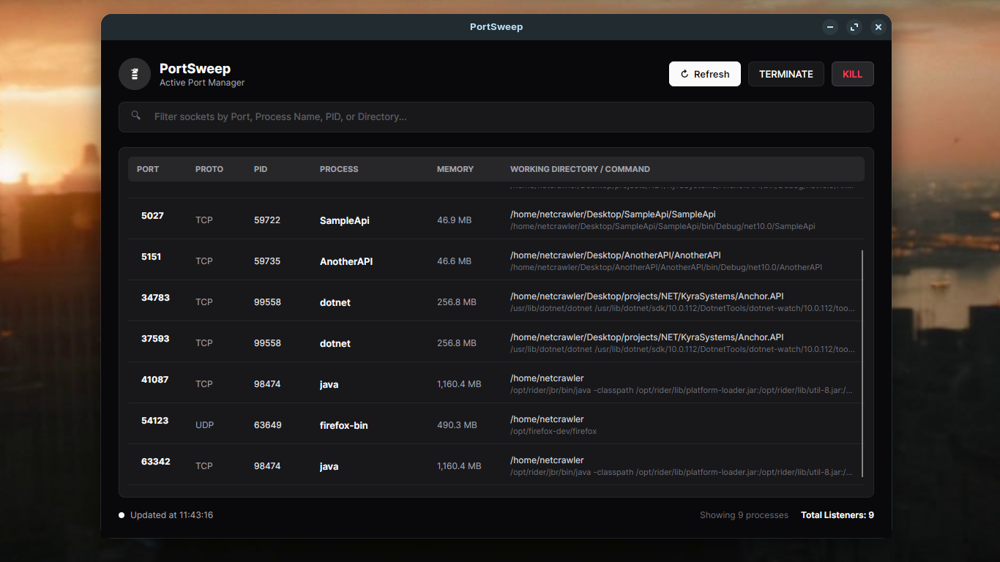

<h1>PortSweep</h1>

yet another app to list what is blocking your ports so u can nuke them

shows active ports and the processes using them, with options to terminate or kill selected processes.

## Screenshots

<table>
<tr>
<td width="100%">

</td>
</tr>
</table>

> [!NOTE]
> i haven't written a single line of code

## License

PortSweep is licensed under the [MIT License](LICENSE).
